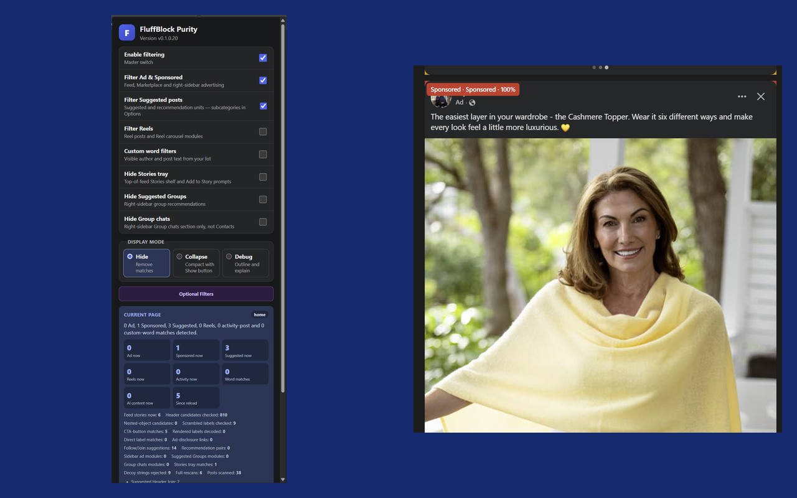

# FluffBlock Purity


A browser extension that cleans up your Facebook feed. It hides or collapses ads, Sponsored posts, Suggested posts, Reels, Stories, sidebar suggestions and posts that match words you choose. **Clean feed. Clear mind.**



## 🌟 Features

- **Ads and Sponsored**: filters advertising in the feed, on Marketplace (including the "Ads" carousel on item pages) and in the right sidebar
- **Suggested posts**: hides Suggested and recommendation units, with six subcategories you can switch on or off (Follow, Join, People You May Know, Suggested/Recommended For You, Suggested Groups, other suggested content)
- **Reels and Stories**: optionally hides Reel posts and Reel carousels, and the Stories tray
- **Sidebar**: optionally hides Suggested Groups and the Group chats section, without hiding your normal Contacts
- **Custom word filters**: hides posts whose visible author, story or link-preview text contains a word or phrase from your own list
- **Activity post filters**: seven opt-in filters for Facebook-generated stories (game and app posts, Became Friends, Liked a Page, Joined a Group, Attending an Event, Attended an Event, Products Shown)
- **AI content label**: optional filter for Meta's own "AI info" / "AI content" label (off by default, not yet verified against many live captures)
- **Home feed sorting**: opens Facebook's home page on the feed you pick instead of the algorithmic order: Most recent, Favorites, Friends, Groups or Pages
- **Marketplace listing age**: optionally forces Marketplace to show listings from the last 24 hours, 7 days or 30 days
- **Three display modes**: **Hide** removes matches, **Collapse** leaves a compact bar with a Show button, **Debug** outlines and labels matches so you can see what is being filtered
- **Reveal and Reapply**: show everything that was filtered on the current page, then turn filtering back on, from the popup
- **Diagnostics**: a status panel for the current page, plus optional "Export diagnostics" and "Export DOM" files for troubleshooting
- **Private**: works entirely in your browser, with no analytics, accounts or tracking

## 🌍 Supported Languages

- English (Facebook set to English)

Detection relies on the wording Facebook uses for labels such as "Sponsored". Other display languages are not supported yet.

## 📦 Installation

### Option 1: Browser stores (Recommended)

- **Chrome Web Store**: listing coming soon
- **Firefox Add-ons**: listing coming soon

### Option 2: Chrome manual installation (development)

1. Clone this repository:
   ```bash
   git clone https://github.com/Fudnut/fb_filter_feeder.git
   ```
2. Open `chrome://extensions/`
3. Turn on **Developer mode**
4. Click **Load unpacked**
5. Select the cloned folder (the one that contains `manifest.json`)

### Option 3: Firefox manual installation (development)

1. Clone the repository (as above)
2. Open `about:debugging`
3. Click **This Firefox**
4. Click **Load Temporary Add-on...**
5. Select `manifest.json` in the cloned folder
6. The add-on stays loaded until you restart Firefox

### Option 4: Userscript (Safari on macOS, Tampermonkey, Violentmonkey)

The `userscript/` folder wraps the same code for userscript managers, including the free **Userscripts** app for Safari. Build it with:

```bash
node userscript/build.mjs
```

This produces `fb-feed-filter.user.js`. In the userscript version an **FF** button on the page opens the settings panel in place of the toolbar popup.

## 🚀 Usage

1. Install the extension and open [facebook.com](https://www.facebook.com)
2. It starts working at once. Ad and Sponsored and Suggested filtering are on by default.
3. Click the toolbar icon to switch filters on or off, choose a display mode and see what was found on the current page
4. Click **Optional Filters** (or open the extension's options page) for the Suggested subcategories, activity filters, custom word list, home feed sorting and Marketplace listing age
5. To check what is being filtered, set the display mode to **Debug**. Matches stay visible with a coloured outline and a label that says why they matched.
6. In Hide or Collapse mode, use **Reveal all** in the popup to see everything that was filtered, then **Reapply** to filter again

If Facebook changes its pages and something stops being filtered, open the popup and use **Export diagnostics**. See [Contributing](#-contributing).

## 🛠️ Technical Details

### How It Works

1. A content script runs on `facebook.com` and watches the page for changes
2. Each feed story is checked for Facebook's own labels (such as "Sponsored" and "Suggested for you"), header actions, structural markers and your word list
3. A matching story gets `data-fffc-*` attributes that record what it matched and why
4. CSS in `content.css` hides, collapses or outlines the story, depending on your display mode
5. Everything runs inside your browser. Nothing is sent anywhere.

### File Structure

```text
fb_filter_feeder/
├── manifest.json        # Manifest V3 definition (Chrome and Firefox)
├── core.js              # Shared rules: label matching, word filter handling, settings keys
├── content.js           # Content script: scans the page, classifies stories, applies filters
├── content.css          # Hide, collapse and debug styling
├── popup.html/.js/.css  # Toolbar popup: filters, display mode, status, Reveal/Reapply, exports
├── options.html/.js/.css# Options page: subcategories, activity filters, word list, home feed
├── icons/               # Extension icons (16, 32, 48, 64, 128 px)
├── userscript/          # Wrapper that builds a userscript version
├── store-assets/        # Store images and screenshots (not part of the extension package)
├── STORE-SUBMISSION.md  # Notes for Chrome Web Store and Firefox Add-ons submission
├── CHANGELOG.md         # Full version history
└── LICENSE              # Mozilla Public License 2.0
```

There is no build step and no bundler for the extension itself. The files load directly from `manifest.json`.

### Permissions

| Permission | Why it is needed |
|---|---|
| `storage` | Saves your filter settings. Your custom word list is kept in local storage only and is never synced. |
| `activeTab` and `scripting` | The popup can re-inject the extension's own packaged scripts into the current Facebook tab if they are not running yet |
| Host access to `facebook.com` and `*.facebook.com` | Lets the content script read the page so it can find and hide matching posts. It runs on Facebook only. |

The extension loads no remote code and makes no network requests.

### Detection Notes

- Facebook disguises some labels (for example by scrambling the letters of "Sponsored" in the page markup). The extension checks rendered text, aria labels, referenced SVG symbols, glyph order and other signals.
- A Facebook layout change can break a detector. The popup's diagnostics and the console warning on the extension's Errors page exist to show this early.

## 🤝 Contributing

### Reporting Issues

- Check the existing [issues](https://github.com/Fudnut/fb_filter_feeder/issues) first
- Include the extension version (shown in the popup) and your browser and version
- Say what you expected and what happened, and on which Facebook page
- Attach the file from **Export diagnostics** if you can. It holds counts and detector information, not post text.
- **Export DOM** files can contain visible page text, names and links. Read one before you share it, and remove anything private.

### Development Setup

```bash
git clone https://github.com/Fudnut/fb_filter_feeder.git
cd fb_filter_feeder
# edit the files, then load the folder as an unpacked extension (see Installation)
```

To package a release, zip `manifest.json`, `core.js`, `content.js`, `content.css`, `popup.*`, `options.*`, the `icons` folder, `LICENSE` and `CHANGELOG.md`, with `manifest.json` at the root of the zip.

### Code Style

- Plain JavaScript, no framework and no build tooling. Keep it that way.
- Reuse the existing conventions: `data-fffc-*` attributes for classification state, the `fffc:` prefix on extension messages, and the `counters` object for instrumentation
- Text a user types, such as the word list, goes in `storage.local`, never `storage.sync`
- The page logic runs against live Facebook markup and cannot be unit tested. Add or extend a `counters.*` field so the diagnostics export shows whether a fix fired.

## 📜 Privacy Policy

- ✅ All filtering happens locally in your browser
- ✅ No Facebook page content, posts, messages or account details are sent to the developer or anyone else
- ✅ No analytics, advertising or tracking
- ✅ No account needed
- ✅ Custom word filters stay in local storage and are not synced
- ✅ Export files are created only when you click, and saved on your device

The extension reads visible page content on `facebook.com` on your device to classify posts. The full policy is in [STORE-SUBMISSION.md](STORE-SUBMISSION.md#5-privacy-policy-host-this-text).

## 📄 License

This project is licensed under the Mozilla Public License 2.0. See the [LICENSE](LICENSE) file for details. Earlier releases (before 0.1.0.20) were published under the MIT licence.

## 🔄 Changelog

The full history is in [CHANGELOG.md](CHANGELOG.md). Recent versions:

### Version 0.1.0.20 (2026-11-08)
- **Renamed to FluffBlock Purity** (short name FluffBlock), with new FBP shield icons including 32 and 64 px
- **Custom word filters now use local storage**, so words you type are never synced to your browser account. Existing lists are moved over automatically.
- Licence changed from MIT to **MPL 2.0**
- Options page: descriptions for the Favorites, Friends, Groups and Pages choices, AI content label moved under Custom word filters, beta wording removed

### Version 0.1.0.19 (2026-11-05)
- Fixed a false "none from literal disclosure text" warning that appeared on the browser's extension Errors page when every ad was found by its Shop Now / Learn More button

### Version 0.1.0.18 (2026-11-04)
- **Home feed sorting**: open Facebook on Most recent, Favorites, Friends, Groups or Pages
- First attempt at fixing the false disclosure warning
- Diagnostics report the last home feed redirect

### Version 0.1.0.17 (2026-10-03)
- Detects the "Ads" carousel on Marketplace item pages
- The right-sidebar Sponsored section now follows the Sponsored toggle

### Version 0.1.0.16 and earlier
- See [CHANGELOG.md](CHANGELOG.md): detection hardening, the Suggested and activity filters, the pre-scan that removes the "flash" of an ad before it is hidden, the userscript build and more

## 🚧 Open Items

- [ ] More display languages (detection is English only)
- [ ] Verify the AI content label filter against more live captures
- [ ] Deleted Friends alerts (disabled until stable IDs and repeated-session testing make false alerts unlikely)
- [ ] Export diagnostics from the userscript version (only the popup version has it)

## 💬 Support

- **Issues**: [github.com/Fudnut/fb_filter_feeder/issues](https://github.com/Fudnut/fb_filter_feeder/issues)
- **Email**: beachie41@gmail.com

## ⚠️ Disclaimer

FluffBlock Purity is an independent project. It is not affiliated with, sponsored by or endorsed by Meta Platforms, Inc. Facebook is a trademark of Meta Platforms, Inc. Facebook can change its pages at any time, which may stop some filters working until the extension is updated. Use at your own risk.

---

**If FluffBlock Purity cleans up your feed:**
- ⭐ Star the repository
- 🐛 Report bugs with a diagnostics file
- 📢 Share it with friends
